# MDNotePad+ 사용 안내 — 화면으로 보기

[README](../README.md)의 기능 소개를 **화면 하나씩** 따라가며 설명합니다. 그림의 저장소 · 문서는 설명을 위해 만든
예시(`업무노트` · `개인메모`)이고, 동기화 화면은 시험용 WebDAV 서버(`127.0.0.1`)에 연결한 모습입니다.

| 차례 | |
|---|---|
| [1. 두 가지 모드](#1-두-가지-모드) | 단순 모드와 동기화 모드 |
| [2. 저장소 검색](#2-저장소-검색) | 여러 저장소에서 찾기 · "모든 저장소" · 검색 색인 |
| [3. 문서 안에서 찾기](#3-문서-안에서-찾기) | Ctrl+F · 다이어그램 안의 글자 |
| [4. 원격(WebDAV) 동기화](#4-원격webdav-동기화) | 원격 줄 읽는 법 · 가져오기 · 방향 고르기 |
| [5. 트리 오른쪽 클릭](#5-트리-오른쪽-클릭) | 원격 문서 모두 받기 · 탐색기에서 열기 |
| [6. 휴대폰으로 넘기기 (QR)](#6-휴대폰으로-넘기기-qr) | PC 화면의 QR 을 휴대폰으로 읽기 |
| [7. 설정](#7-설정) | 설정 항목과 파일 위치 |
| [8. 자주 묻는 것](#8-자주-묻는-것) | |

---

## 1. 두 가지 모드

### 단순 모드 — 그냥 실행하거나 `.md` 를 두 번 눌렀을 때

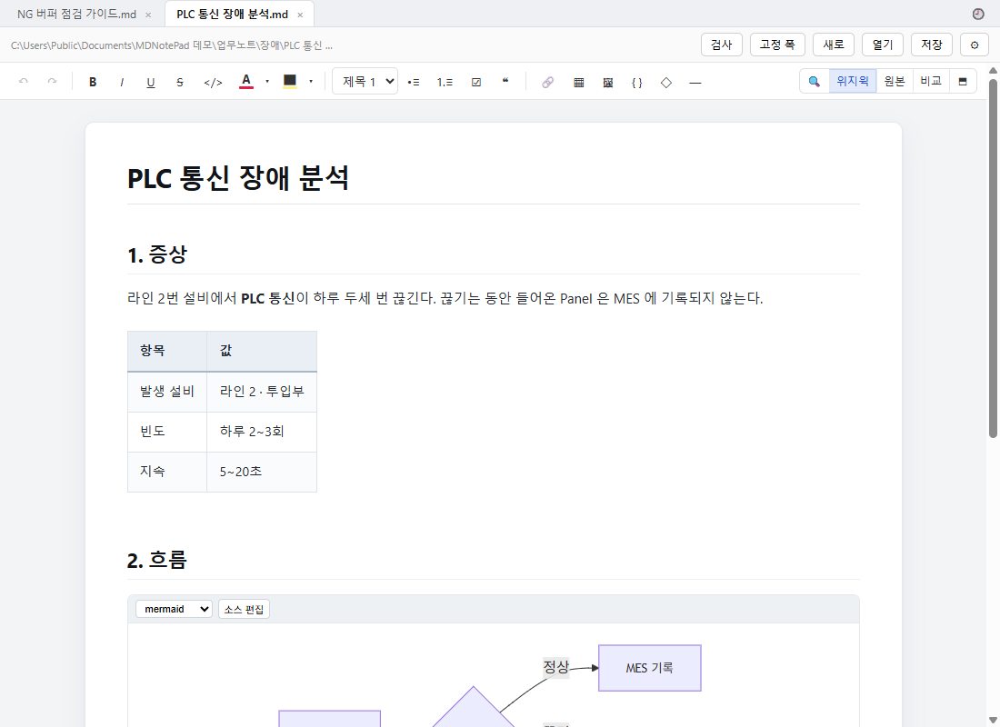

메모장처럼 **탭과 편집 화면만** 있습니다. 저장소 · 동기화 · Git 이 없고, 창을 여러 개 띄울 수 있습니다.
윗줄 오른쪽의 **위지윅 / 원본 / 비교**로 보는 방식을 바꿉니다.

### 동기화 모드 — `--sync` 를 붙여 실행했을 때

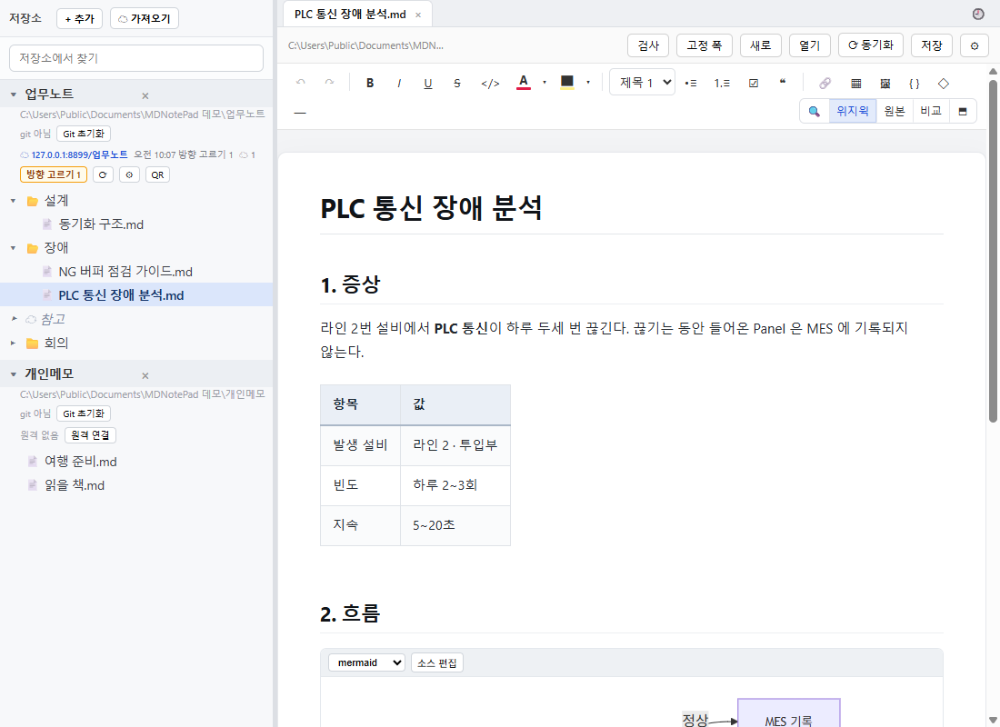

| 자리 | 무엇 |
|---|---|
| 왼쪽 위 **저장소 · + 추가 · ☁ 가져오기** | 폴더를 저장소로 등록하거나, 원격에서 저장소를 받아 옵니다 |
| **저장소에서 찾기** 칸 | 등록한 저장소 전체에서 글자를 찾습니다 ([2절](#2-저장소-검색)) |
| 저장소 머리 (`업무노트`) | 저장소 이름 · 실제 폴더 · Git 상태 · 원격 줄 ([4절](#4-원격webdav-동기화)) |
| 트리 | 폴더를 펼쳐 문서를 엽니다. ☁ 표시는 원격에만 있고 아직 받지 않은 것입니다 |
| 오른쪽 위 **⟳ 동기화** | 원격이 붙은 저장소를 모두 점검합니다 |

동기화 모드는 **한 창만** 뜹니다. 이미 떠 있으면 그 창이 앞으로 옵니다.

---

## 2. 저장소 검색

왼쪽의 **저장소에서 찾기** 칸에 글자를 넣으면 바로 찾습니다. 결과는 **파일별로 묶이고**, 맞은 줄과 줄 번호,
저장소 이름, 고친 날짜가 함께 나옵니다. 줄을 누르면 그 문서가 열리고 그 줄로 갑니다.

### "모든 저장소" 체크

| 켜면 (기본) | 끄면 |
|---|---|
| 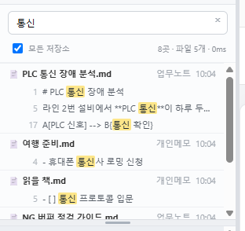 | 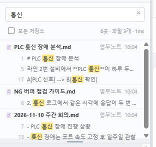 |
| **등록한 모든 저장소**에서 찾습니다. 위 그림에는 `개인메모` 의 `여행 준비.md` · `읽을 책.md` 도 나옵니다 | **지금 탭에 열린 문서가 든 저장소만** 찾습니다. 위 그림은 `업무노트` 의 문서를 열어 둔 상태라 `업무노트` 결과만 나옵니다 |

- 끈 상태에서 **열린 문서가 없거나, 열린 문서가 등록된 저장소 밖에 있으면** 찾을 곳이 없습니다.
  이때는 "지금 열린 문서가 등록된 저장소 안에 없어 찾을 곳이 없습니다" 가 나옵니다 — 체크를 켜세요.
- 찾기는 **부분 글자**로 합니다. "통신" 으로 "통신이" · "통신사" 도 찾고, 대소문자를 가리지 않습니다.
- 한 문서에서는 20줄, 전체는 300줄까지 보여 줍니다. 더 있으면 "결과가 많아 일부만 보여줍니다" 가 나옵니다.

### 검색 색인 (1.16.6부터)

결과 위의 `8곳 · 파일 5개 · 0ms` 처럼 **찾는 데 걸린 시간**이 나옵니다. 저장소 문서의 글을 미리 담아 둔
**색인**에서 찾기 때문에 문서가 많아도 빠릅니다.

- 앱이 뜰 때 뒤에서 색인을 맞춰 둡니다. 처음 한 번만 문서를 모두 읽고, 그 뒤로는 **바뀐 문서만** 다시 읽습니다.
- 다른 편집기에서 고친 문서도 찾을 때 뒤에서 확인해, 바뀌었으면 결과를 한 번 더 고쳐 보여 줍니다.
- 색인 파일: `%LOCALAPPDATA%\MdWorkspace\search-index.sqlite` — 문서 글의 **사본**입니다. 앱을 닫고 지워도 되고,
  다음에 찾을 때 다시 만듭니다. 저장소 폴더에는 아무것도 쓰지 않습니다.
- 색인을 쓸 수 없으면(파일을 만들 수 없음 등) 예전처럼 폴더를 직접 훑어 찾고, 결과 위에 **"· 직접 훑음"** 이 붙습니다.

---

## 3. 문서 안에서 찾기

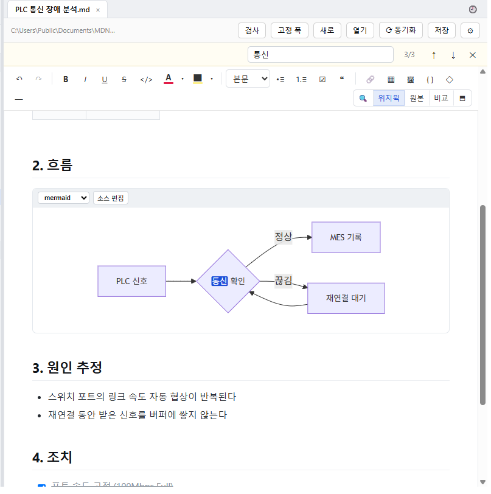

**Ctrl+F** 또는 편집 화면 오른쪽 위의 **🔍** 를 누르면 찾기 줄이 열립니다 (지금 문서 안에서만 찾습니다).

- **Enter** 다음, **Shift+Enter** 이전, **Esc** 닫기. 숫자(`3/3`)는 지금 위치 / 전체입니다.
- 찾은 자리로 화면이 저절로 움직입니다.
- **Mermaid 다이어그램 안의 글자도 찾습니다.** 지금 위치는 위 그림처럼 **파란 바탕에 흰 글자(반전)**, 나머지는 노란 바탕입니다.
  다이어그램 안의 글자는 마우스로 끌어 고르고 복사할 수도 있습니다.

---

## 4. 원격(WebDAV) 동기화

### 원격 줄 읽는 법

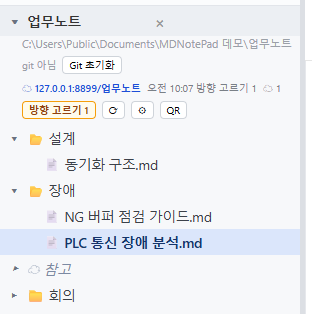

저장소 이름 아래 `☁ 127.0.0.1:8899/업무노트 …` 줄이 원격 상태입니다.

| 보이는 것 | 뜻 |
|---|---|
| `☁ 서버/폴더` | 연결된 원격. 빨간 글씨면 마지막 동기화가 실패한 것 — 마우스를 올리면 이유가 보입니다 |
| `오전 10:07 ↓2 ↑1` | 마지막으로 맞춘 시각, 받은(↓) · 올린(↑) 문서 수. 할 일이 없었으면 "맞음" |
| `☁ 1` | 원격에만 있고 아직 받지 않은 문서 수. 열면 그 문서를 받습니다 |
| **방향 고르기 1** | 양쪽에 있는데 함께 맞춘 적이 없어 손대지 않고 기다리는 문서 (아래) |
| **⟳** · **⚙** · **QR** | 지금 맞추기 · 원격 설정 바꾸기/해제 · 휴대폰으로 보내기 ([6절](#6-휴대폰으로-넘기기-qr)) |

### 원격에서 가져오기 / 원격 연결

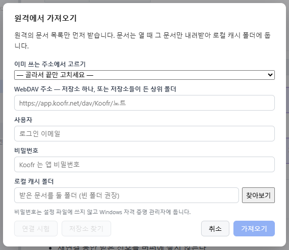

- **☁ 가져오기**: 원격에 이미 있는 저장소를 받습니다. 목록만 먼저 받고, 문서는 열 때 받습니다.
  - **WebDAV 주소**에 저장소 하나, 또는 **여러 저장소가 든 상위 폴더**를 넣고 **저장소 찾기**를 누르면 그 아래 저장소들을 골라 한꺼번에 받습니다.
  - **이미 쓰는 주소에서 고르기**: 다른 저장소에서 쓰는 주소를 고른 뒤 끝만 고치면 됩니다. 같은 계정이면 비밀번호를 다시 넣지 않아도 됩니다.
- **원격 연결** (저장소 머리의 단추): 이미 있는 로컬 폴더에 원격을 붙입니다. 처음 맞출 때 그 폴더의 문서를 올립니다.
- **연결 시험**: 주소 확인 → 폴더 만들기 → 쓰기 → 읽기 → 지우기 순서로 서버를 시험하고 어느 단계에서 막혔는지 보여 줍니다.
- 비밀번호는 설정 파일이 아니라 **Windows 자격 증명 관리자**에 저장합니다. Koofr 는 "앱 비밀번호" 를 만들어 씁니다.

### 방향 고르기 — 처음 만난 문서

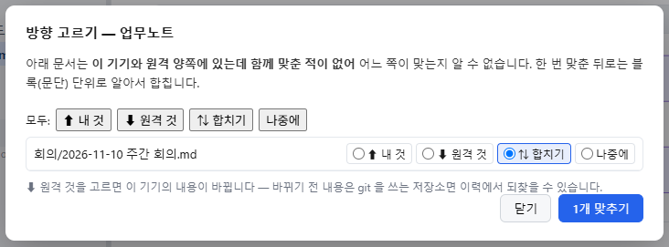

같은 이름의 문서가 **이 기기와 원격 양쪽에 있는데 함께 맞춘 적이 없으면**, 어느 쪽이 맞는지 알 수 없어
그 문서는 맞추지 않고 기다립니다. 원격 줄의 **방향 고르기** 를 눌러 문서마다(또는 "모두:") 고릅니다.

| 고르기 | 결과 |
|---|---|
| **⬆ 내 것** | 이 기기의 내용이 맞습니다. 원격을 덮습니다 |
| **⬇ 원격 것** | 원격 내용이 맞습니다. 이 기기의 문서를 덮습니다 — Git 을 쓰는 저장소면 이전 내용을 이력에서 되찾을 수 있습니다 |
| **⇅ 합치기** | 같은 문단은 하나로, 다른 문단은 양쪽 다 남깁니다 |
| **나중에** | 고르지 않고 둡니다. 고를 때까지 그 문서는 맞추지 않습니다 |

한 번 맞춘 문서는 그 뒤로 **문단(블록) 단위**로 알아서 합칩니다. 두 기기에서 같은 문단의 같은 줄을 고쳤을 때만
양쪽 내용이 담긴 충돌 블록이 생깁니다.

### 지우기

동기화한 문서나 그림을 지우면(트리에서든 탐색기에서든, 앱이 꺼져 있을 때든) **원격과 다른 기기에서도 지워집니다.**
지운 뒤 다른 기기에서 고친 것이 있으면 고친 것이 남습니다. 한꺼번에 20개 넘게 · 절반 넘게 사라지면
(폴더를 옮겼거나 드라이브가 빠진 경우) 지운 것으로 치지 않고 알려 줍니다.

---

## 5. 트리 오른쪽 클릭

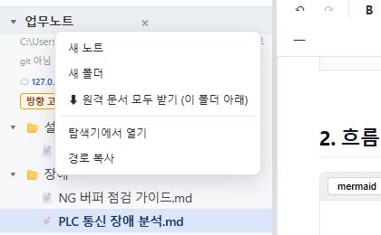

| 메뉴 | 동작 |
|---|---|
| 새 노트 · 새 폴더 | 그 폴더 안에 만듭니다 |
| **⬇ 원격 문서 모두 받기 (이 폴더 아래)** | ☁ 로 표시된 문서를 한꺼번에 받습니다 — 비행기 안 · 휴대폰처럼 나중에 연결이 없을 때 미리 |
| 탐색기에서 열기 | 그 폴더를 Windows 탐색기로 엽니다 |
| 경로 복사 | 전체 경로를 클립보드에 |
| (문서) 단순 모드로 열기 (새 창) | 그 문서를 단순 모드 새 창으로 엽니다 |
| 이름 바꾸기 (F2) · 삭제 | 삭제는 휴지통으로 갑니다 |

저장소 머리에 마우스를 올리면 **↻**(새로고침 — 트리와 원격 목록 다시 읽기)와 **▲▼**(저장소 순서 바꾸기)가 나옵니다.

---

## 6. 휴대폰으로 넘기기 (QR)

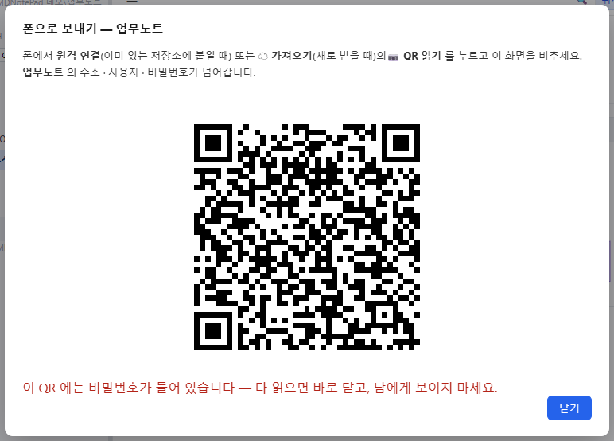

휴대폰에서 주소 · 이메일 · 앱 비밀번호를 치지 않아도 됩니다.

1. PC 저장소 원격 줄의 **QR** 을 누릅니다 (저장소마다 따로).
2. 휴대폰의 **원격 연결**(이미 있는 저장소에 붙일 때) 또는 **☁ 가져오기**(새로 받을 때)에서 **📷 PC 화면의 QR 읽기**.
3. PC 화면을 비추면 주소 · 사용자 · 비밀번호가 채워집니다.

QR 에는 비밀번호가 들어 있습니다 — 읽은 뒤 바로 닫고 다른 사람에게 보이지 마세요.

---

## 7. 설정

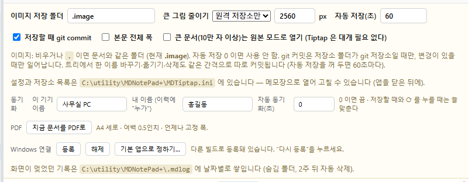

오른쪽 위 **⚙** 로 엽니다.

| 항목 | 설명 |
|---|---|
| 이미지 저장 폴더 | 붙여 넣은 그림을 둘 폴더 (문서 옆 `.image`) |
| 큰 그림 줄이기 | 1MB 넘거나 긴 변이 정한 픽셀보다 큰 그림을 줄여 WebP 로. 기본은 **원격 저장소만** |
| 자동 저장(초) | 0 이면 끔 |
| 저장할 때 git commit | 저장소가 Git 저장소일 때만 |
| 동기화 — 이 기기 이름 · 내 이름 | 충돌 블록과 이력에 "누가" 로 나옵니다 |
| 자동 동기화(초) | 0 이면 끔. 저장할 때와 ⟳ 를 누를 때는 늘 맞춥니다 |
| PDF · Windows 연결 | 지금 문서를 PDF 로 · 탐색기 오른쪽 클릭 등록 · **기본 앱으로 정하기…** |

파일 위치

| 무엇 | 어디 |
|---|---|
| 설정 · 저장소 목록 | 실행 파일 옆 `MDTiptap.ini` (`--home` 으로 바꿀 수 있음) |
| 멎었을 때의 기록 | 실행 파일 옆 숨김 폴더 `.mdlog` (2주 뒤 자동 삭제) |
| 검색 색인 | `%LOCALAPPDATA%\MdWorkspace\search-index.sqlite` |
| 원격 비밀번호 | Windows 자격 증명 관리자 (휴대폰은 앱 데이터 폴더) |
| 동기화 기록 | 각 저장소의 `.mdsync` 폴더 (Git 이 무시하도록 되어 있음) |

---

## 8. 자주 묻는 것

**"모든 저장소" 를 껐더니 아무것도 안 나와요.**
열린 문서가 없거나, 열린 문서가 등록된 저장소 밖에 있으면 찾을 곳이 없습니다. 체크를 켜거나 저장소 안의 문서를 여세요.

**`.md` 를 두 번 눌렀는데 다른 프로그램이 열려요.**
Windows 는 프로그램이 스스로 기본 앱이 되게 두지 않습니다. 설정 → Windows 연결 → **다시 등록** 후 **기본 앱으로 정하기…** 에서 `.md` 를 MDNotePad+ 로 고르세요.

**같은 내용인데 "밖에서 바뀌었습니다" 를 물어요.**
1.16.2 부터 내용이 같으면 묻지 않습니다. 계속 나오면 `.mdlog` 를 첨부해 알려 주세요.

**검색 색인 파일이 커요.**
문서 글의 사본이라 저장소 문서 크기만큼 됩니다. 앱을 닫고 지워도 다음 찾기 때 다시 만들어집니다.
